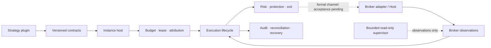

<h1 align="center">Robinhood Trading Infra</h1>

<p align="center">
  <strong>Build strategies as plugins. Keep execution, risk, and audit in the infrastructure.</strong>
</p>

<p align="center">
  <a href="LICENSE"></a>
  
  
  <a href="CONTRIBUTING.md"></a>
</p>

<p align="center">
  <strong>English</strong> · <a href="README.zh-CN.md">简体中文</a><br>
  <a href="#quick-start">Quick start</a> ·
  <a href="#architecture">Architecture</a> ·
  <a href="#bring-your-own-strategy">Strategy plugins</a> ·
  <a href="CONTRIBUTING.md">Contribute</a>
</p>

---

An unofficial, Robinhood-oriented trading infrastructure project for developers,
quantitative researchers, and coding agents. Develop and test strategy plugins
without putting broker access, account risk, or order management inside the strategy.

The infrastructure owns execution state, budgets, attribution, reconciliation,
and audit. Strategies consume structured inputs and produce versioned decisions.
Broker-facing components sit behind adapters; **a plugin never receives broker
credentials, a broker handle, or order authority**.

> **Research preview.** Offline and synthetic workflows are available. This
> release is not a production trading system: live execution is disabled, and
> formal broker connectivity, confirmation behavior, protection/exit and machine
> recovery still require acceptance against the current candidate.

## What you get

- **Pluggable strategies** — versioned contracts, Python entry-point discovery,
  conformance checks, an external plugin template, and Agent-oriented guides.
- **Instance isolation** — checkpoints, account budgets, symbol leases, trade
  attribution, and accounting for multiple strategy instances.
- **Execution lifecycle components** — durable actions, claim/dispatch states,
  reconciliation, protection/exit logic, and recovery boundaries.
- **Offline research** — synthetic backtests and dry runs, with explicit modeling
  and deployment boundaries.
- **Bounded observation** — a preflight-first read-only entry point with getter
  budgets, deadlines, and owned-process cleanup evidence.
- **Local audit** — durable records for inspection and post-session review.

## Quick start

Requires **Python 3.11+** and [uv](https://docs.astral.sh/uv/getting-started/installation/).

```bash
git clone https://github.com/GordonBai/robinhood-trading-infra.git
cd robinhood-trading-infra
uv sync --frozen

# Inspect the CLI, then run a synthetic $500 sizing example.
uv run --frozen martin-agentic --help
uv run --frozen martin-agentic dry-run --scenario examples/dry_run_500.json
```

The dry run does not submit an order or call a broker. Installing dependencies
may access package registries. The existing distribution name `martin-agentic`
and CLI `martin-agentic` are retained for compatibility; they are not the project
name or a claim of affiliation.

Next: follow the [plugin quick start](docs/plugins/QUICKSTART.md) to build an
external strategy wheel, run conformance checks, and exercise a synthetic
backtest using the documented installation and source-identity requirements.

## Architecture



| Layer | Responsibility |
|---|---|
| `infra/src/trading_contracts/` | Immutable strategy, instance, market, decision, and exit contracts |
| `infra/src/trading_infra/` | Plugin/instance host, budgets, leases, attribution, and accounting |
| `infra/src/martin_agentic/` | Execution lifecycle, broker facts, risk, protection/exit, audit, recovery, and CLI |
| `strategy/martin_luk/` | A concrete strategy and its application composition |
| `strategy/examples/` | Independent example strategies and an example application |
| `examples/plugins/example_momentum/` | Buildable external plugin template with synthetic inputs |

The diagram describes code responsibilities, not verified live deployment.
See [Architecture](docs/ARCHITECTURE.md) and [Repository layout](docs/REPOSITORY_LAYOUT.md).

## Bring your own strategy

1. Implement the [plugin protocol](docs/plugins/PROTOCOL.md), including its
   descriptor, configuration, data requirements, and decision contract.
2. Package your provider with the `trading_infra.strategies` entry point.
3. Run the documented `plugin check` and `plugin backtest` workflows against
   synthetic inputs before considering deployment.
4. Treat deployment as a separate acceptance process. Installing a plugin does
   not authorize trading.

| Guide | Use it for |
|---|---|
| [Plugin quick start](docs/plugins/QUICKSTART.md) | Build, install, and exercise the external example |
| [Plugin protocol](docs/plugins/PROTOCOL.md) | Implement the versioned integration contract |
| [Agent guide](docs/plugins/AGENT_GUIDE.md) | Help a coding agent turn a strategy into a plugin |
| [Backtest and deployment](docs/plugins/BACKTEST_AND_DEPLOY.md) | Understand simulation semantics and deployment limits |
| [Read-only collection](docs/READ_ONLY_COLLECTION.md) | Prepare bounded observations without order authority |
| [Operations](docs/OPERATIONS.md) | Inspect execution, audit, and recovery boundaries |

Python plugins are trusted code, **not a sandbox**. Review third-party plugins
before installing them.

## Validation and current limits

| Area | Current evidence |
|---|---|
| Core execution, isolation, and plugin components | Local offline/synthetic verification |
| Installed regression suite | 2,737 tests run: 2,723 passed, 14 optional audit-SDK skips, zero failures/errors |
| Release installation and plugin example | Clean install and synthetic smoke checks passed |
| Bounded formal read-only collection | Preflight verified; market-session acceptance of this candidate pending |
| Formal Host execution and confirmation | End-to-end acceptance pending; no confirmation waiver claimed |
| Normal live protection/exit and machine recovery | Current-candidate real-environment acceptance pending |
| Unattended production trading | Not enabled or claimed |

The full regression result belongs to executable baseline `ee4f4871…`.
Executable code, tests, configuration, and lock files are unchanged in this
publication; public documentation has been updated. No profit or live-readiness
claim follows from a synthetic backtest.

Risk limits are configured by policy. Local flags and Agent prompts never
replace formal tool confirmation. This release is source and documentation,
not trading authorization.

## Contributing

**Issues, bug reports, documentation improvements, strategy plugins, and pull
requests are welcome.** If you call them merge requests, you are welcome too—on
GitHub, please open a Pull Request.

Read [CONTRIBUTING.md](CONTRIBUTING.md), keep changes focused, and include the
relevant offline verification. Never submit credentials, account data, private
ledgers, or raw broker recordings.

## License and attribution

[MIT License](LICENSE) · Copyright (c) 2026 Gordon Bai.

This is an independent project, not affiliated with or endorsed by Robinhood,
Martin Luk, or any broker, data provider, or third-party strategy author.
Third-party code and data retain their respective licenses.
