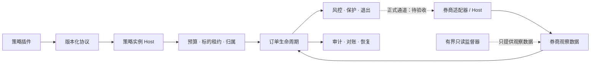

<h1 align="center">Robinhood Trading Infra</h1>

<p align="center">
  <strong>策略作为插件接入，下单生命周期、风控和审计交给基础设施。</strong>
</p>

<p align="center">
  <a href="LICENSE"></a>
  
  
  <a href="CONTRIBUTING.md"></a>
</p>

<p align="center">
  <a href="README.md">English</a> · <strong>简体中文</strong><br>
  <a href="#快速开始">快速开始</a> ·
  <a href="#项目架构">项目架构</a> ·
  <a href="#接入你自己的策略">策略插件</a> ·
  <a href="CONTRIBUTING.md">参与贡献</a>
</p>

---

一个面向开发者、量化研究员和 Coding Agent 的非官方 Robinhood 交易基础设施项目。
你可以编写、测试自己的策略插件，而无需把券商访问、账户风控和订单管理混入策略逻辑。

基础设施负责执行状态、预算、归属、对账和审计；策略接收结构化输入，输出符合版本化协议的决策。
券商相关组件位于适配器之后。**策略插件不会获得券商凭据、券商句柄或下单权限。**

> **当前为研究预览版。** 已提供离线与合成数据工作流，尚不能作为生产交易系统使用。
> 实盘执行保持禁用；当前候选的正式券商连接、确认链路、保护退出和实机恢复仍需进一步验收。

## 提供哪些能力

- **可插拔策略**：版本化接口、Python entry point 发现、契约检查、外部插件模板和 Agent 接入指南。
- **策略实例隔离**：独立检查点、账户预算、标的租约、成交归属与记账，支持多个策略实例的基础机制。
- **订单生命周期组件**：持久化动作、认领与派发状态、对账、保护退出及恢复边界。
- **离线研究**：合成数据回测与 dry run，明确区分模拟语义和真实部署。
- **有界只读观察**：默认先做预检查，设有读取预算、截止时间和进程清理证据。
- **本地审计**：保留可检查的持久化记录，便于排查和复盘。

## 快速开始

需要 **Python 3.11+** 和 [uv](https://docs.astral.sh/uv/getting-started/installation/)。

```bash
git clone https://github.com/GordonBai/robinhood-trading-infra.git
cd robinhood-trading-infra
uv sync --frozen

# 查看命令，再运行一个使用合成数据的 500 美元仓位计算示例。
uv run --frozen martin-agentic --help
uv run --frozen martin-agentic dry-run --scenario examples/dry_run_500.json
```

dry run 不会提交订单或调用券商。安装依赖时可能访问软件包源。
为了兼容现有安装，Python 发行包和 CLI 暂时保留 `martin-agentic` 名称；它不是项目展示名，也不代表任何官方关联。

下一步可按[插件快速入门](docs/plugins/QUICKSTART.md)构建外部策略 wheel，运行契约检查与合成回测。
请遵循指南中的安装方式和源码身份要求。

## 项目架构



| 目录 | 职责 |
|---|---|
| `infra/src/trading_contracts/` | 不可变的策略、实例、行情、决策与退出协议 |
| `infra/src/trading_infra/` | 插件与实例 Host、预算、租约、归属和记账 |
| `infra/src/martin_agentic/` | 订单生命周期、券商事实、风控、保护退出、审计恢复与 CLI |
| `strategy/martin_luk/` | 一个具体策略及其应用组合 |
| `strategy/examples/` | 独立示例策略与示例应用 |
| `examples/plugins/example_momentum/` | 可构建的外部策略插件模板及合成输入 |

架构图说明代码职责，不代表实盘部署已经验收。详见[架构说明](docs/ARCHITECTURE.md)与[目录说明](docs/REPOSITORY_LAYOUT.md)。

## 接入你自己的策略

1. 按[插件协议](docs/plugins/PROTOCOL.md)实现描述符、配置、数据需求和决策接口。
2. 将 provider 打包，声明 `trading_infra.strategies` entry point。
3. 按指南运行 `plugin check` 与 `plugin backtest`，先验证合成输入下的行为。
4. 把部署视为独立验收过程：安装插件不等于授权交易。

| 文档 | 适用场景 |
|---|---|
| [插件快速入门](docs/plugins/QUICKSTART.md) | 构建、安装和运行外部示例 |
| [插件协议](docs/plugins/PROTOCOL.md) | 实现版本化的接入接口 |
| [Agent 指南](docs/plugins/AGENT_GUIDE.md) | 让 Coding Agent 帮你把策略转为插件 |
| [回测与部署](docs/plugins/BACKTEST_AND_DEPLOY.md) | 理解模拟语义及部署边界 |
| [只读采集](docs/READ_ONLY_COLLECTION.md) | 在没有下单权限的情况下准备有界观察 |
| [运维说明](docs/OPERATIONS.md) | 检查执行、审计和恢复机制 |

Python 插件是需要信任的代码，**不是沙箱**。安装第三方插件前应审阅其代码。

## 验证进度与当前边界

| 板块 | 当前证据 |
|---|---|
| 核心执行、实例隔离与插件组件 | 已完成本地离线／合成验证 |
| 安装版完整回归 | 共运行 2,737 项：2,723 通过，14 项可选审计 SDK 测试跳过，零失败与错误 |
| 发布包安装与插件示例 | 干净安装与合成数据冒烟检查通过 |
| 正式有界只读采集 | 预检查通过，当前候选的交易时段正式验收待完成 |
| 正式 Host 执行与确认 | 端到端验收待完成，不宣称支持绕过逐单确认 |
| 正常实盘保护退出与实机恢复 | 当前候选的真实环境验收待完成 |
| 无人值守生产交易 | 未启用，也不作此承诺 |

完整回归对应执行代码基线 `ee4f4871…`。本次发布的执行代码、测试、配置和锁文件与该基线一致，
公开文档已更新。合成回测结果不代表真实收益或生产可用性。

风险限额由策略外部的 policy 配置。本地开关和 Agent 提示词不能替代正式工具确认。
本次发布交付源码和文档，不授予交易权限。

## 欢迎参与贡献

**欢迎提交 Issue、Bug 报告、文档改进、策略插件和 Pull Request！**
如果你习惯称为 MR，也欢迎参与；在 GitHub 上请使用 Pull Request。

请先阅读[贡献指南](CONTRIBUTING.md)，保持改动聚焦，并附上相关离线验证结果。
请勿提交凭据、账户数据、私有账本或券商原始录音／记录。

## 许可与版权

[MIT License](LICENSE) · Copyright (c) 2026 Gordon Bai。

本项目独立开发，与 Robinhood、Martin Luk、任何券商、数据提供方或第三方策略作者均无隶属或背书关系。
第三方代码与数据仍遵循各自的许可证。
