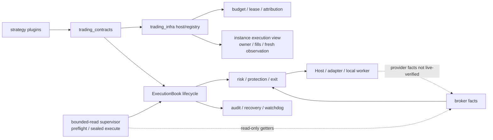

# Architecture

Generic `infra/` owns contracts, isolation, execution facts, risk, protection/exit lifecycle, the live supervisor and Host/worker composition. Installed external providers are discovered from the `trading_infra.strategies` entry-point group and use the same instance/Book/admission runtime. `strategy/martin_luk/` owns Martin screening/entry/exit; `strategy/examples/` owns the independent example plugin catalog and session composition. Dependency direction is enforced by `tests/test_dependency_direction.py` and `tests/test_runtime_decoupling.py`: generic infra has no module-level strategy import, and only explicit CLI selection lazy-loads an application composition.

The 30-second protection anchor, claim/lease, UNKNOWN, partial-fill,
receipt/attribution and recovery boundaries remain in the execution owner.

Two read-only entry points are part of the current structure. `bounded-read`
runs a side-effect-free preflight by default; an explicitly approved execute
atomically claims a fresh target, seals the verified source/pin/policy/protected
inputs, and runs one bounded read-only session with a getter budget and cleanup
proof. The instance execution view aggregates attribution ownership, the
instance's fills/accounting, current owner action state and the execution
owner's latest broker observation; activity time and observation freshness are
separate, and `available_quantity` is `unknown` without reservation evidence.
Neither entry point adds order authority.

## Validation boundary

The executable, test, config and lock tree is byte-identical to the accepted
local baseline `ee4f4871…`; its installed full is 2737 tests, 2723 passed, 14
optional audit-SDK skips, 0 failures/errors. This revision changes public
documentation only. This is local package/full evidence, not deployment or
formal acceptance.
Provider/live behavior, formal Host confirmation, unattended or
per-order-confirmed support, fresh real quote acceptance, the normal real
protection close loop and OS/machine recovery are not verified by this
structure. The tree is not deployed; live execution is disabled;
`production_ready=false`. These are future production gates, not prerequisites
for the open-source release.
